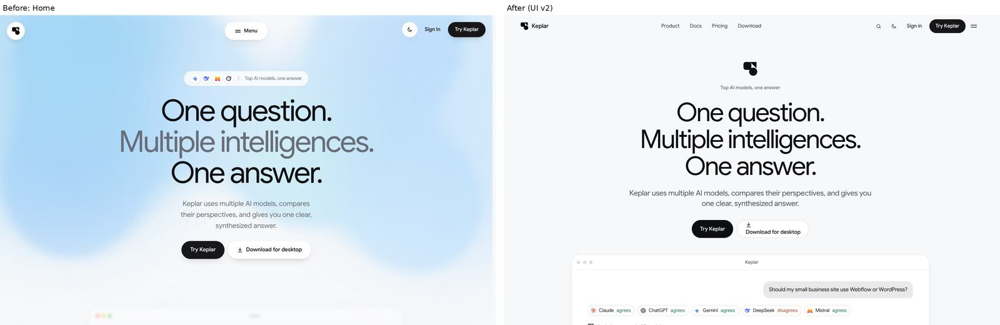
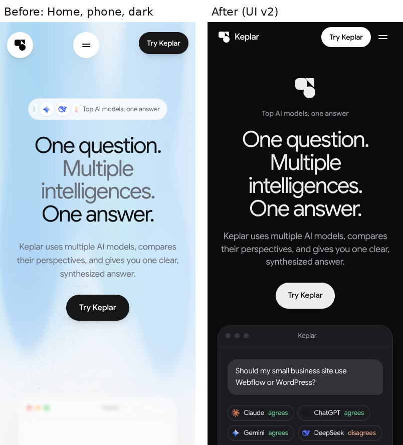
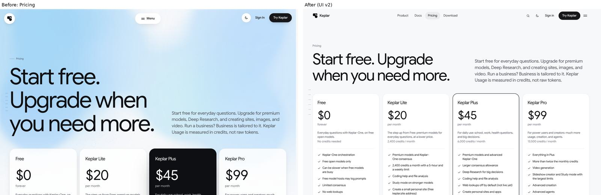
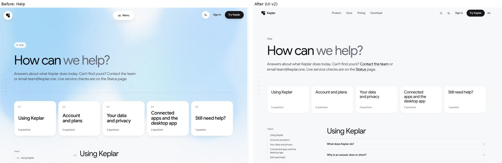
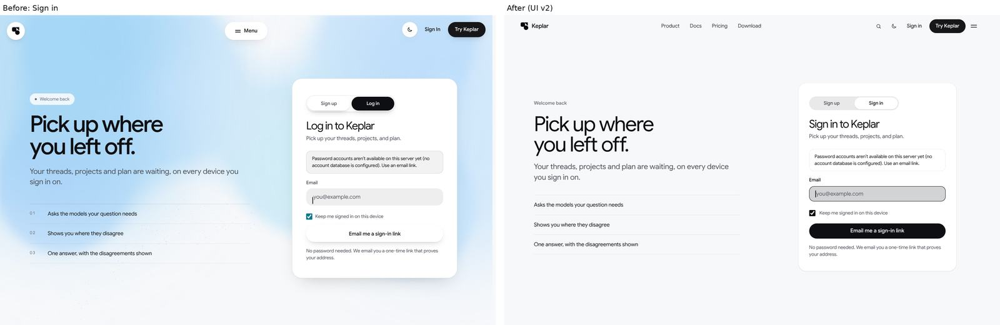
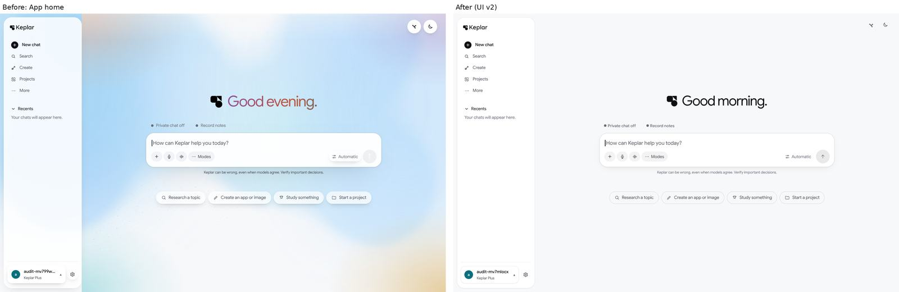
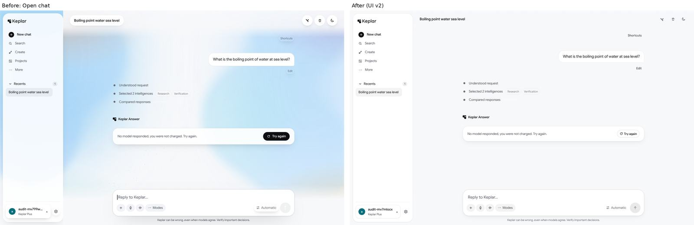
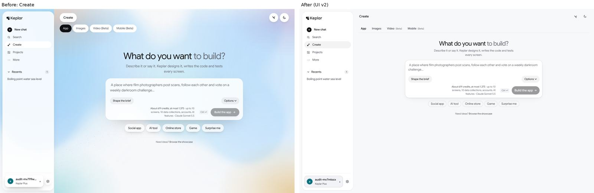
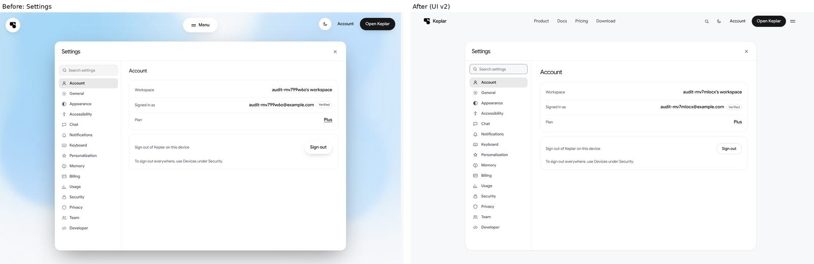
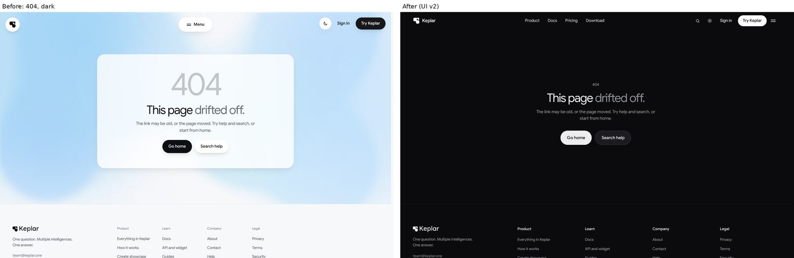

# Keplar One UI v2: the one design system

Every screen on keplar.one (public site, sign-in, the app, Settings) is drawn from this system. If a screen needs something this
file does not cover, add it to the system, not to the screen. Keplar Business (business.keplar.one) and Space Studio
(space.keplar.one) are separate products with their own looks and are out of scope.

## Principles

1. **Calm canvas.** Pages sit on the plain canvas (`--c-canvas`) in both themes. There is no backdrop art, no aura, no blurred
   blobs and no dot ribbons behind content, and no gradient text. Brand character comes from the Keplar mark, type and spacing.
2. **One surface ladder.** Use canvas, then `--surface-raised` (cards, inputs, composer), then `--surface-overlay` (menus,
   dialogs, sheets: always opaque). Edges use `--hairline` / `--hairline-strong`; depth uses `--elev-1/2/3`. Do not add new
   glass (`backdrop-filter`) to content surfaces.
3. **One ink action per area.** A primary action is an ink pill: `--c-ink` background, `--c-canvas` text. Everything else is
   secondary (hairline pill), quiet (text) or an icon button that fills on hover.
4. **Type does the hierarchy.** The type is Google Sans (`--f-sans`).
   - Display and titles: regular weight with tight tracking.
   - Body: `--c-ink-2`. Meta: `--c-ink-3`.
   - Kickers are plain small text in `--c-ink-3` (sentence case), not pills, not mono all-caps.
5. **Restrained motion.** Hover changes colour or shadow; press is a `var(--m-press)` scale. There is no swell, squash,
   magnetic pull, card jump or animated glow. Overlays use motion.css (`usePresence` / `useExit`). Reduced motion is honoured.
6. **Accessible by default.**
   - Text holds WCAG AA (4.5:1; 3:1 for large text).
   - Targets are at least 24x24 (44 on touch).
   - Keyboard focus uses the site cue (a brightness shift plus an underline or bar). It is never an outline box (owner rule,
     `e2e/no-focus-box`).

## Tokens (src/styles/tokens.css, light.css)

| Group | Tokens |
|---|---|
| Ink | `--c-ink`, `--c-ink-2`, `--c-ink-3`, `--c-ink-hover` |
| Canvas and surfaces | `--c-canvas`, `--surface-panel`, `--surface-raised`, `--surface-overlay`, `--c-surface-1/2` |
| Lines and fills | `--hairline`, `--hairline-strong` (decorative), `--field-border` (text field edges, 3:1), `--hover-wash`, `--press-wash` |
| Depth | `--elev-1` (resting), `--elev-2` (raised), `--elev-3` (floating) |
| Semantic | `--c-verified`, `--c-attention`, `--c-destructive`, `--c-reasoning`, `--c-research`, `--c-creation`, `--c-memory`; fills `--v-*` |
| Radius | `--r-xs 10`, `--r-sm 14`, `--r-md 18`, `--r-card 24`, `--r-card-lg 28`, `--r-pill`; shapes `--shape-control 14`, `--shape-card 22` |
| Space | `--s-1` … `--s-48` (4px grid) |
| Type | `--t-display`, `--t-headline`, `--t-title`, `--t-lead`, `--t-body`, `--t-small`, `--t-label` |
| Motion | `--m-dur-1/2/3`, `--m-ease-out/in/spring`, `--m-press` |

No hex or rgb literals in component CSS. A colour that is not a token is a new token.

## Components

### Marketing and page CTAs: `src/components/ui/Button.tsx`

- `ButtonLink` / `Button`, with variants `primary | secondary | quiet` and sizes `sm | md | lg`.
- Pills. `primary` is ink. `secondary` is `--surface-raised` with a hairline. `quiet` is text.

### Product UI and anything interactive: the kit, `src/components/kit` (import from `@/components/kit`)

- **Controls:** `Button` (`primary | secondary | ghost | danger`, `sm | md | lg`), `IconButton` (always has a label), `Switch`,
  `Checkbox`, `SegmentedControl`, `Tabs`.
- **Overlays:**
  - `Dialog` (native `<dialog>`, focus trap, Escape, focus return).
  - `Menu` / `MenuItem` / `Popover` (top layer, arrow keys).
  - `Tooltip` (use instead of `title=` for icon buttons).
- **Feedback:**
  - `confirmAction({ title, body, confirmLabel, danger })` returns `Promise<boolean>`. Never call `window.confirm`.
  - `notify({ title, description, tone, action })` shows a toast. Do not build new toast components.
  - `Badge`, `StatusDot`, `Progress`, `ActivityIndicator`, `EmptyState`.
- **Icons:** `Icon` (`kit/icons/glyphs`).
- **Densities:** the kit reads `--ks-*` variables.
  - Site-wide values live in `src/styles/kit.css`: Keplar One proportions, 40px controls, colours from the product tokens.
  - Keplar Studio sets its denser values on `<StudioRoot>`. Do not set `--ks-*` anywhere else.

### Page building blocks

- **Page hero:** `components/page/PageHero` / `RoutePlaceholder`. A kicker, a title (`--t-headline`, regular, tracking -0.04em),
  a lead in `--c-ink-2`, then at most one primary and one secondary CTA.
- **Cards:** `--surface-raised`, a 1px `--hairline` (inset box-shadow or border), `--r-card`, `--elev-1`. Hover strengthens
  the edge to `--hairline-strong` (no lift).
- **Section rhythm:** `--s-24` between sections on desktop, `--s-16` on phones; the content max-width is `--l-max`; text
  measure is at most 68ch.

## What is gone (do not reintroduce)

- **Backdrops:** `SkyBackdrop` (now the shared weather sky, `WeatherSky`; see docs/design/space-ui.md).
- **Glass:** glass surfaces on content (`.lg`, `--lg-fill` used as a background outside the app).
- **Legacy button effects:** `lit.css` proximity light, `Magnetic`, `ButtonFx`, and the swell/squash transforms.
- **Global rewrites:** the class-name button rule in `redesign.css` (anything containing btn/chip/pill/cta got a drop shadow)
  and the frosted-pill kicker rewrite.
- **Native confirm:** `window.confirm`.
- **One-off overlays:** hand-rolled toasts and dialogs.

## Rollout and verification (October 2026)

UI v2 replaced the earlier look on every keplar.one screen in one change. The work was split into a foundation and six areas: the
home page; marketing and pricing; docs and help; sign-in and account; the app shell and chat; and Create, Studio and the remaining
app panels. Each area was then moved onto the kit and tokens above.

Before and after (left: the previous build, right: UI v2), in `docs/assets/ui-v2/`:

| Screen | Comparison |
|---|---|
| Home (desktop, light) |  |
| Home (phone, dark) |  |
| Pricing |  |
| Help |  |
| Sign in |  |
| App home |  |
| App answer |  |
| Create |  |
| Settings |  |
| 404 (dark) |  |

Checks run on the integrated build:

- `next build`: passes.
- `npm test`: 2838 pass. Three failures also fail on `main`: two Keplar Browser acceptance tests and the Business sign-out
  test. A fourth (the Space Studio presence "leave beacon") failed once under full-suite load and passes on its own.
- `scripts/interface-audit.mjs` (axe, target size, overflow): no violations on the app screens. Two findings are intentional:
  the sign-in checkbox (its label is the target) and the Settings tab row on phones (it scrolls sideways).
- Playwright e2e: every failure that remains was checked against a build of `main` run the same way, with the same result.
  The 19 files with failures ran on both: 49 failures matched and none were new. These tests have not caught up with the
  product. They include:
  - `/enterprise` now redirects to business.keplar.one.
  - The starter cards are gone from Ask home.
  - Settings has no "Advanced" tab; Team and Developer are separate tabs.
  - `/developers` has no "Keplar API" h1.
  - The template gallery has no "Community templates · Beta" heading, and its report button is "Report this template".
  - The home page no longer has the Creation section, the `#hero-q` headline or the FAQ disclosure. The sidebar has no
    Agents or Projects buttons, and some app routes redirect to business.keplar.one.
- Bugs found and fixed during integration:
  - The /app shell made the kit's toasts and confirm dialog inert. The host is now marked `data-kit-host` and left out.
  - A toast replaced in place by id kept its old timer. A sticky toast that became a timed one closed at once.
  - The account menu, now a kit popover, was a fixed 300px. On a 320px phone it ran past the sidebar. It is now capped at
    the sidebar row's width.
